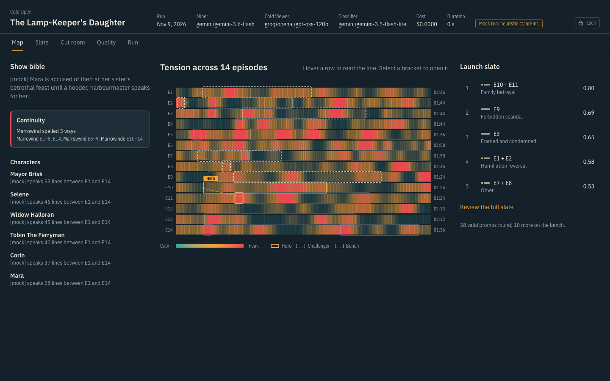
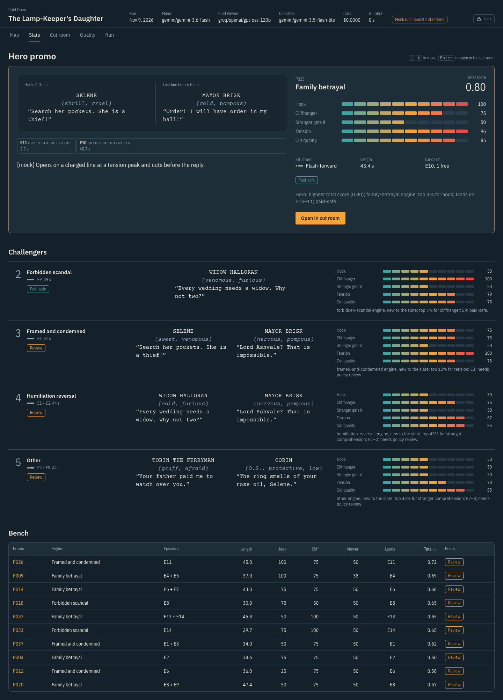
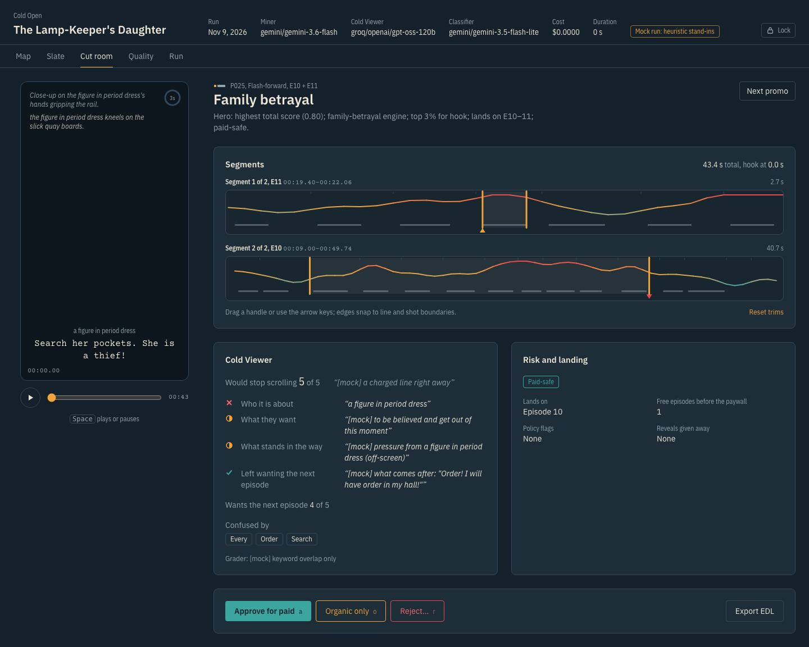
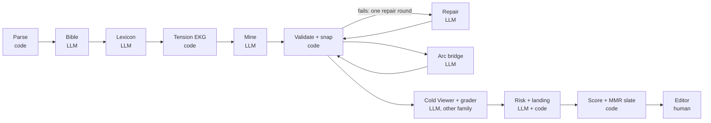

# Cold Open

Cold Open reads a microdrama screenplay (a folder of timestamped episode scripts) and returns a ranked
**launch slate** of promos: 20–60 second cuts that hook in the first 3 seconds, end on a cliffhanger and make
sense to a stranger. Editors review them in a web cutting room and export CMX3600 EDLs and a CSV cut list.

**AI judges meaning. Code owns facts. The editor makes the final call.** The model only ever names line IDs.
Code turns them into timecodes, enforces every hard rule and ranks. A person approves, trims or rejects.



<table><tr>
<td></td>
<td></td>
</tr></table>

Screenshots show *The Lamp-Keeper's Daughter*, an invented demo show (`examples/`), run with offline stand-in
models.

## Quick start

```bash
uv sync                                   # Python 3.11+
cp .env.example .env                      # add GEMINI_API_KEY, GROQ_API_KEY and a DEMO_ACCESS_CODE
uv run coldopen models                    # model names your keys can use; paste them into config.yaml
uv run coldopen llm-ping                  # one tiny call per role: tokens, cost, latency

uv run coldopen run --input data/pack --out runs/demo --title "My show"
cd web && npm ci && npm run build && cd ..
uv run coldopen serve                     # http://127.0.0.1:7860
```

No keys yet? Run the whole pipeline offline with deterministic stand-ins:

```bash
uv run python scripts/make_demo_show.py "examples/The Lamp-Keeper's Daughter"
uv run coldopen run --input "examples/The Lamp-Keeper's Daughter" --out runs/demo-lamp --provider mock
```

`--input` takes a folder or a `.zip`. `--max-episodes 3` makes a quick test run. `--stages mine,snap` recomputes only
those stages and loads the rest from the run folder.

## How it works



| Stage | Who | What it does |
|---|---|---|
| Parse | code | Every timed block becomes an atom with an ID (`E01.042`). Fails loudly with file, line and what was expected. |
| Bible | LLM | Characters with episode-scoped aliases, arcs, reveals, and which code-detected spelling drifts are truly one entity. |
| Lexicon | LLM | Arousal and valence for each free-text delivery tag; cached per model across shows. |
| Tension EKG | code | Per-second loudness from tags, punctuation, violent verbs, sound and camera cues. Cheap recall, blind to meaning. |
| Mine | LLM | 3–6 candidates per episode by atom ID, including one quiet line away from the loud peaks; then cross-episode arc bridges. |
| Validate | code | IDs, hook within 3 s, 20–60 s, no cut through a spoken line, verbatim quotes, snapping to shot changes, dedupe, continuity warnings. One LLM repair round, then a reason-coded rejection. |
| Cold Viewer | LLM (judge) | Sees only what a scroller sees: faces described, never named. Would it stop? What did it understand? A grader checks that against the bible. |
| Risk | LLM + code | Ad-policy level and evidence, reveals given away, landing episode and free runway before the paywall. |
| Slate | code | Transparent weighted score minus penalties; MMR picks a hero and challengers that differ in engine, episodes and footage. |

Outputs per run (`runs/<name>/`): every LLM call (`llm_calls/`), each stage's artifact (`00_` … `08_`), `promos.csv`,
`promos.md`, `edl/*.edl`, `run_report.json` (tokens, cost, stage timings, counts, constraint pass rates) and
`decisions.jsonl` from the UI.

## Free API tiers and limits

Free keys are small: a free Gemini key allows only 20 requests a day for the best Flash model, and Groq's free tier
allows 8,000 tokens a minute. Cold Open is built to live inside that:

- **Fallbacks:** each role lists fallback models with their own quotas (`fallbacks:` in `config.yaml`). A daily-quota
  error skips the back-off and moves to the next model at once. Every call records `answered_by`.
- **Partial results:** if every model for a role is out, the run still finishes. Mining skips the remaining
  episodes, the Cold Viewer skips the remaining promos (and the slate falls back to miner scores if it judged none),
  and each skip becomes a counted, plain-English note. The UI shows a "Partial run" banner instead of an error.
- **The show bible:** the only stage that cannot proceed without a model. The CLI prints which limit was hit and
  when it resets, then exits with code 2. Every finished call is cached, so running the same command later resumes.
- **Hosted demo:** runs on the server's keys cover the first 3 episodes (`COLDOPEN_SERVER_KEY_MAX_EPISODES`), so one
  visitor cannot spend the day's quota for everyone. Visitors can bring their own key for a whole show.

Your own limits: https://aistudio.google.com/rate-limit (Gemini) and https://console.groq.com/settings/limits (Groq).

## Swapping models

Models are chosen per **role** in `config.yaml`. Changing one is a one-line edit with no code change:

```yaml
models:
  miner: "gemini/<model>"        # bible, mining, repair
  judge: "groq/<model>"          # the Cold Viewer: a different family on purpose
  classifier: "gemini/<model>"   # lexicon, grader, risk
```

Prices go in `prices.yaml` (USD per million tokens, from each provider's pricing page). An unknown price gives
`cost: null`, never a guess. `--provider replay` re-runs from the response cache with no network, which reproduces
a recorded run exactly. On a slow free tier, `judge_limit: 40` judges only the top 40 valid promos. Rate limits apply per
provider (`rpm`, `rpm_by_provider`), and `fallbacks:` names a model to try when one stays overloaded after retries.

## Evaluation

1. Write `eval/gold.yaml` by hand (about 15 promos you would cut), using `coldopen show E01` to read timecodes:
   ```yaml
   - id: G01
     episode: 1
     start: "00:33.0"
     end: "01:05.0"
     note: "what happens"
   ```
2. `uv run coldopen ablate --input data/pack --out runs/ablate` runs four variants: `rules` (no LLM), `llm_only`
   (the model writes timestamps, nothing checks them), `no_viewer` and `full`.
3. `uv run coldopen eval --run runs/ablate/full --ablate runs/ablate --rate` asks for blind 1–5 ratings of the top 10
   and a Cold Viewer audit, then writes `eval/eval_report.{json,md}`: hit rate, cut error, precision@10, constraint
   pass rates, rejection reasons, ablation table and a failure gallery.
4. `uv run coldopen doc --run runs/ablate/full --notes docs/my_words.yaml` renders the 2-page solution PDF from those
   numbers. The notes file (`why_this_problem`, `tools_used`, `failures_confirmed`) holds the author's own words; any
   box left empty prints as a visible TODO.
   `uv run coldopen bundle --run runs/ablate/full` zips the raw outputs.

## Review UI

| Screen | For |
|---|---|
| Map | Tension across every episode, with the slate's brackets on top. Hover to read the line; select a bracket to open it. |
| Slate | Hero spread (screenplay-set hook and cliffhanger, VU-meter scores, rationale), challengers, sortable bench. Keys `j` `k` `Enter`. |
| Cut room | Real-time 9:16 phone animatic with a 3-second hook ring, trim handles that snap to line and shot boundaries and re-validate live, Cold Viewer answers, risk, and decisions (`a` approve, `o` organic, `r` reject). EDL export includes trims. |
| Quality | Candidate funnel, results ledger, overlap with gold, ablations as small multiples, failure gallery. |
| Run | Upload a zip, pick models, use your own key (never stored), watch stages stream in. |

Accessibility: keyboard reachable throughout, visible focus, reduced-motion support, WCAG AA contrast in both themes
(checked with axe-core on every screen).

## Security

| Concern | What the app does |
|---|---|
| Who can read a run | Demo runs need the access code. The page trades it once (`POST /api/access`) for an HMAC-signed bearer token that expires after 8 hours, and never keeps the code itself. A run started with your own API key gets a token for that run only. |
| Revoking access | Change `DEMO_ACCESS_CODE`: the signing key includes it, so every session ends at once. |
| Guessing the code | 8 wrong tries per client in 15 minutes, and 100 across all clients, return `429` with `Retry-After`. Comparisons are constant-time. The server warns at start if the code is shorter than 12 characters. |
| Secrets in URLs and logs | None. Downloads and the progress stream send headers through `fetch`; query-string credentials are ignored. Provider keys are used for one run, never written to disk, and redacted from error messages. |
| CSRF and iframes | No cookies, so nothing is sent automatically. That also works inside the Hugging Face iframe, where browsers block third-party cookies. |
| Uploads | 20 MB cap, read in chunks. The zip is never extracted, and the server rejects path escapes, encrypted entries, more than 200 scripts, or a compression ratio above 100 (zip bombs). At most 2 runs at once, and 6 per client per hour. |
| Editor trims | The server re-checks every hard rule (20–60 s, hook within 3 s, cliffhanger kept, no cut inside a spoken line) before saving a decision. The UI checks too, but code owns the facts. |
| Browser hardening | CSP with `script-src 'self'` and `frame-ancestors` limited to Hugging Face, `nosniff`, `no-referrer`, `no-store` on every API response, run IDs restricted to a safe pattern, and static paths kept inside the build folder. |

Generate a code with `python -c "import secrets; print(secrets.token_urlsafe(12))"`. Set `SESSION_SECRET` (or rely on
the `SPACE_SIGNING_SECRET` that Hugging Face injects) so sessions survive restarts. Behind exactly one reverse proxy
the image sets `COLDOPEN_PROXY_HOPS=1`, so lockouts apply to each visitor and are not shared by everyone.

## Deploying (Docker)

The image builds the UI, installs the package and serves both on `$PORT` (default 7860).

**Hugging Face Space.** Docker Spaces now need a paid plan on the account that creates them (PRO for a personal
account; see the [Spaces overview](https://huggingface.co/docs/hub/spaces-overview)).

1. Create a **Docker** Space. Its `README.md` needs this header:
   ```yaml
   ---
   title: Cold Open
   sdk: docker
   app_port: 7860
   ---
   ```
2. Push this repository's tracked files to the Space (never `data/` or `runs/`; both are git-ignored).
3. Add these Space **secrets**: `GEMINI_API_KEY`, `GROQ_API_KEY` and `DEMO_ACCESS_CODE`.
4. Demo runs stay private. Zip the run folder(s) (`cd runs && zip -r runs.zip final`), upload the zip to a **private**
   Hugging Face dataset, and set `DEMO_RUNS_URL` to its `resolve/main/runs.zip` link plus `HF_TOKEN` (a read token).
   `scripts/fetch_demo.py` downloads the zip at start; viewing still needs the access code.

**Free alternative: Render.** Create a Web Service from the GitHub repo with the Docker runtime, add the same
variables under *Environment*, and keep the free instance. Render's [free tier](https://render.com/docs/free) spins
down after 15 minutes idle (about a minute to wake) and has no persistent disk, so demo runs come from `DEMO_RUNS_URL`
in the same way.

Locally: `docker build -t coldopen . && docker run -p 7860:7860 -e DEMO_ACCESS_CODE=... -v $PWD/runs:/data/runs coldopen`.

## Confidentiality

The input pack belongs to the client. `data/`, `runs/`, `.cache/`, the filled solution doc and the master prompt are
git-ignored. `scripts/check_leaks.py` runs as a pre-commit hook and blocks any staged file sharing four or more
consecutive words with a script line. Tests that need the pack are marked `@pytest.mark.pack` and skip without it.
Public tests use an invented 3-episode show in `tests/fixtures/`.

## Development

```bash
uv run pytest                       # unit, pipeline, API and eval tests
cd web && npm run dev               # UI with hot reload, proxied to the API on :7860
uv run python scripts/screens.py RUN_ID OUT_DIR --code CODE   # screenshots at 1440x900 and 390x844
```

`docs/BUILD_LOG.md` records every place generated work was wrong, how it was caught and the fix.

## Limitations

- Text only: cuts follow the script's camera notes, not the real edit, and nothing checks faces or audio.
- The tension signal is loudness. A hearth "fire" scores as violence; meaning comes from the LLM stages.
- Comprehension is judged by a model playing a stranger. The human audit in `coldopen eval --rate` measures how far
  to trust it.
- Costume and location contradictions across an arc bridge are not detected; only spelling drift is.
- Score weights are hand-set defaults, not learned from ad results.

## License

MIT.
